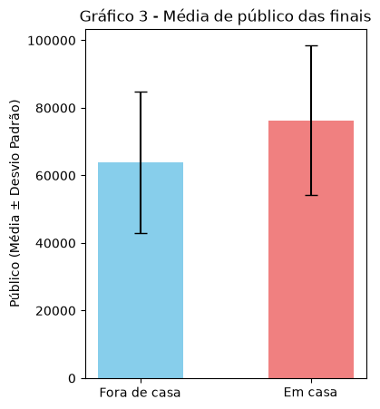
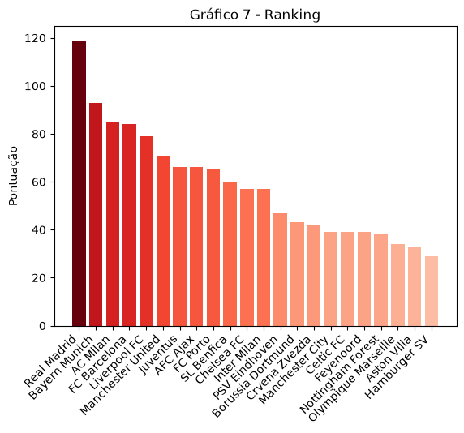

# Análise da UEFA Champions League (1955–2023)

Análise exploratória do histórico da Champions League com Python e Pandas. O projeto investiga se jogar mais partidas leva a mais títulos e se existe um clube que possa ser chamado de "dono" da competição.

## Perguntas da análise

1. Mais jogos significam mais títulos?
2. Existe um time que pode ser considerado o "dono" da Champions League?

## Dados

- **Fonte:** [Champions League Dataset 1955–2023](https://www.kaggle.com/datasets/fardifaalam170041060/champions-league-dataset-1955-2023/data?select=UCL_Finals_1955-2023.csv), no Kaggle (autor: fardifaalam170041060).
- **Arquivos usados:**
  - `UCL_AllTime_Performance_Table.csv`: desempenho histórico de cada clube (jogos, vitórias, empates e derrotas).
  - `UCL_Finals_1955-2023.csv`: todas as finais de 1955 a 2023 (campeão, vice, sede e público).
- **Licença dos dados:** MIT, conforme a página do dataset. O Kaggle indica que os dados são próprios para análise e exploração com fins educativos e de pesquisa.

## Tratamento dos dados

**1. Tabela de desempenho dos clubes (`team`)**
- Renomear as colunas.
- Remover colunas desnecessárias.
- Criar uma coluna de pontuação seguindo o regulamento atual (vitória = 3, empate = 1, derrota = 0).
- Criar uma coluna de taxa de aproveitamento.
- Corrigir valores faltantes.

**2. Tabela das finais (`final`)**
- Criar uma coluna com o país-sede.
- Converter a coluna `Attendance` (público) para inteiro.
- Criar uma coluna que relaciona o país-sede com os países dos times finalistas.

**3. União das tabelas**
- Criar colunas com a quantidade de títulos e de vices de cada time.
- Criar uma coluna com a taxa de aproveitamento nas finais.
- Criar um novo DataFrame filtrando times com um mínimo de partidas ou ao menos um título.

**4. Sistema de pontuação**
- A partir dos times campeões, criar uma pontuação própria (descrita abaixo).

## Sistema de pontuação

Para responder à segunda pergunta, foi criado um sistema próprio de pontuação. Cada time recebe uma nota conforme sua colocação em cinco critérios:

- partidas jogadas
- número de vitórias
- títulos
- segundos lugares
- taxa de aproveitamento nas finais

Para cada parâmetro em análise, foi classificado em ordem crescente e pontuado de acordo com sua posição, com excessão da pontuação do título, onde
a quantidade de **títulos foi multiplicado por 3**, sendo esta a sua pontuação. A pontuação final de cada time foi a soma de todas as notas

## Resultados

### Mais jogos significam mais títulos?



Não há uma relação direta entre partidas e títulos: existem times com quase 200 jogos e nenhum título, enquanto outros, com bem menos jogos, já foram campeões. Por outro lado, todos os times com 3 títulos ou mais têm pelo menos 200 partidas na competição.

### Existe um "dono" da Champions?



O **Real Madrid** é o grande "dono" da competição. Além de ter o maior número de partidas, é o maior campeão, com 14 títulos. Pelo sistema de pontuação criado, o clube somou **119 pontos**, bem à frente do segundo colocado, o Bayern de Munique, com 93.

## Decisões e limitações

- A pontuação 3-1-0 (regulamento atual) foi aplicada a todo o histórico, embora a regra tenha mudado ao longo dos anos.
- O sistema de pontuação foi criado para esta análise. Os critérios e o peso 3 dos títulos são escolhas minhas e podem alterar o ranking final.
- Alguns critérios têm relação entre si (por exemplo, partidas jogadas e vitórias), o que pode favorecer clubes com mais jogos.
- Colunas de gols da tabela original foram descartadas por apresentarem inconsistências.

## Como executar

```bash
git clone https://github.com/dutakeuchi/Champions_league.git
cd Champions_league
pip install -r requirements.txt
jupyter notebook Champions.ipynb
```

## Estrutura do repositório

```
Champions_league/
├── Champions.ipynb                    # análise completa
├── UCL_AllTime_Performance_Table.csv  # dados: desempenho histórico
├── UCL_Finals_1955-2023.csv           # dados: finais
├── imagem/                           # gráficos usados neste README
├── requirements.txt
└── README.md
```

## Tecnologias

Python · Pandas · Matplotlib · Jupyter Notebook

## Autor

**Eduardo Isamu Takeuchi**, estudante de Ciência de Dados para Negócios (FATEC Sebrae).
[LinkedIn](https://www.linkedin.com/in/edu-takeuchi) · [GitHub](https://github.com/dutakeuchi)
